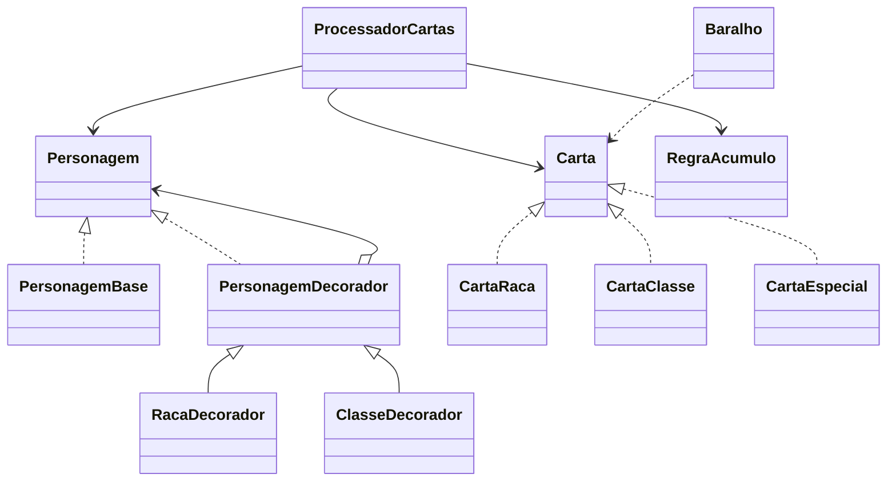

# Sistema de Criação de Personagens no Munchkin

Solução da 2ª Verificação de Aprendizagem — Métodos Avançados de Programação, UEPB.

## Padrão escolhido: Decorator

O padrão Decorator permite acrescentar características a um objeto sem modificar sua classe base. `PersonagemBase` começa como humano sem classe; cada carta de raça ou classe válida envolve o personagem atual em um novo decorador, acrescentando a característica à descrição.

As cartas MESTICO e SUPER_MUNCHKIN são processadas primeiro como permissões de acúmulo. Depois, as cartas de raça e classe são aplicadas respeitando os limites definidos. Assim, as especiais podem aparecer em qualquer posição entre as quatro cartas e ainda habilitar corretamente o segundo espaço. Cartas excedentes são descartadas. As especiais não aparecem na lista de aplicadas, pois habilitam a regra, mas não adicionam raça nem classe à descrição.

## Diagrama simplificado



## Execução

O programa sorteia quatro cartas diferentes do baralho e exibe as recebidas, aplicadas, descartadas e a descrição final.

```bash
javac *.java
java Main
```

## Organização

- `Personagem` e `PersonagemBase`: abstração e personagem inicial.
- `PersonagemDecorador`, `RacaDecorador` e `ClasseDecorador`: adicionam características ao personagem.
- `CartaRaca`, `CartaClasse` e `CartaEspecial`: representam os tipos de carta.
- `RegraAcumulo`: controla os limites de raças e classes.
- `ProcessadorCartas`: valida exatamente quatro cartas, habilita especiais e decide aplicação ou descarte.
- `Baralho`: sorteia quatro cartas.
- `ResultadoProcessamento`: guarda o resultado para exibição.
